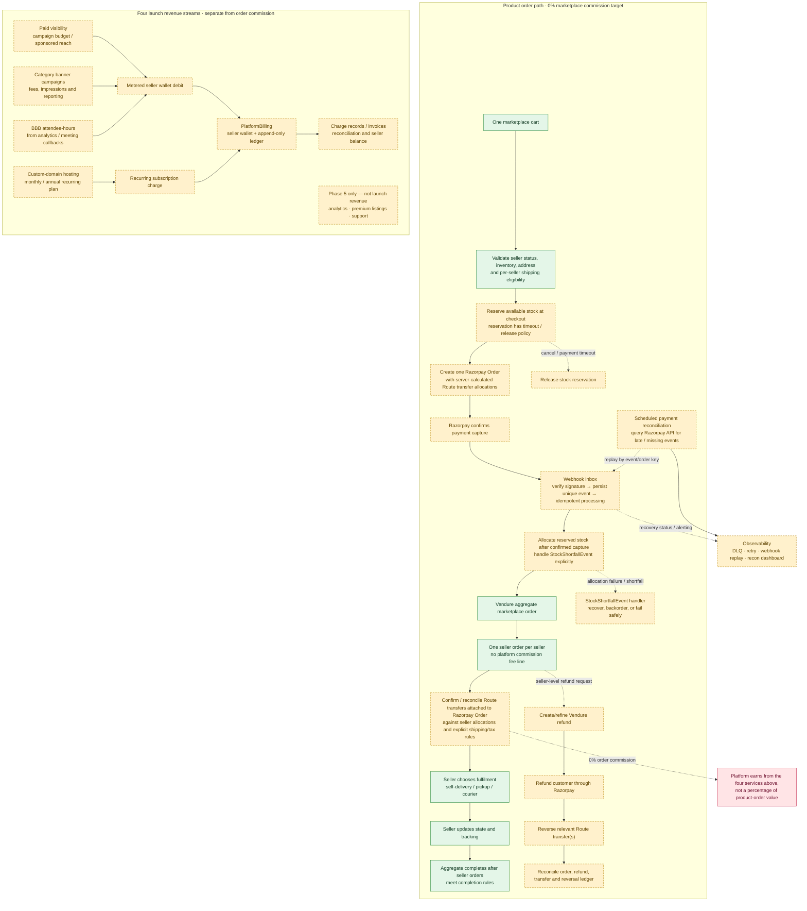
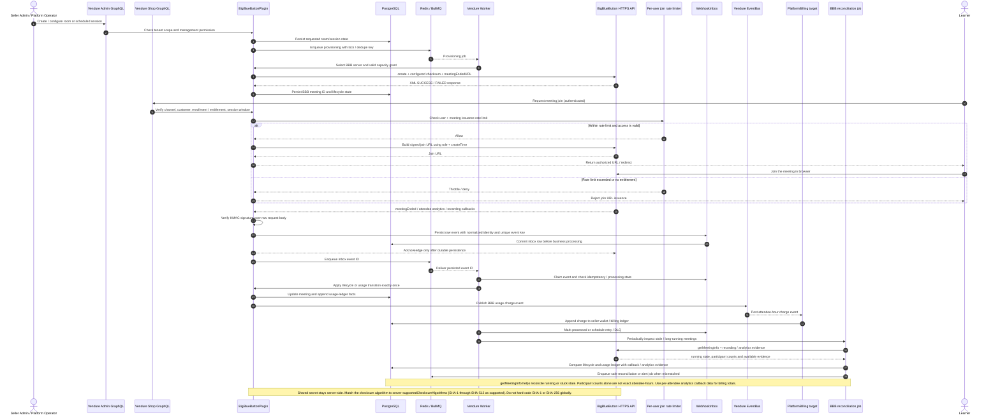

# SellerFronts Mermaid Architecture Pack (Revised)

The canonical editable diagram sources are the five `.mmd` files in [`docs/architecture/sellerfronts-mermaid-v3/`](https://github.com/ashishkpaul/buylits/tree/main/docs/architecture/sellerfronts-mermaid-v3); start with its [README](https://github.com/ashishkpaul/buylits/blob/main/docs/architecture/sellerfronts-mermaid-v3/README.md). This combined document is the readable preview of those sources, not a separate specification. The diagrams distinguish current repository behavior from target architecture; not every target capability is already live.

## 1. Target platform architecture

```mermaid
flowchart TB
  subgraph UX["Customer and seller experiences"]
    CUSTOMER["Customers<br/>Next.js marketplace storefront"]
    SELLER["Seller Admin<br/>Vendure Admin / Dashboard"]
    OPS["Platform Operator<br/>Admin / Dashboard"]
  end

  subgraph API["Vendure Core · NestJS · GraphQL"]
    SHOP["Shop API<br/>catalog · search · cart · checkout · account · join"]
    ADMIN["Admin API<br/>catalog · sellers · orders · campaigns · meetings"]
    CORE["Vendure core<br/>channels · orders · payment state · stock · fulfilment"]
    subgraph KEEP["Existing plugins to keep or refactor"]
      LIFECYCLE["SellerLifecycle<br/>seller state / verification"]
      GEO["SellerGeo"]
      ORDER["Multivendor → MarketplaceOrder"]
      SEARCH["SearchSync + stock projection"]
      PROMO["SellerPromotion"]
      BBB["BigBlueButtonPlugin"]
      PAYCORE["PaymentsCore<br/>provider-neutral PaymentGateway target"]
      DRIVER["DriverFulfillment (optional)"]
      REV["Reviews · Wishlist · CommerceOps<br/>Cashback funding decision"]
      TENANCY["Shared tenancy & permissions policy<br/>Seller Admin: own channel only<br/>Platform Operator: explicit cross-tenant permission"]
    end
    subgraph BUILD["Target plugins / capability gaps"]
      RZPAY["RazorpayPayment<br/>one platform checkout account"]
      PAYOUT["SellerPayoutAccounts<br/>Razorpay Route linked accounts"]
      FULFIL["SellerFulfilment<br/>self-delivery / pickup"]
      COURIER["CourierIntegration<br/>provider adapters + tracking"]
      NOTIFY["Notifications<br/>email · SMS · WhatsApp"]
      BILL["PlatformBilling<br/>wallet + append-only ledger"]
      DOMAIN["StorefrontDomain<br/>custom host + DNS/TLS + plan"]
      CMS["CMS"]
      RETURNS["Returns"]
      DASH["PlatformDashboard"]
      FUTURE["Phase 5 only · future<br/>analytics · premium listings · support"]
    end
  end

  subgraph DATA["Data and asynchronous processing"]
    PG[("PostgreSQL<br/>source of truth")]
    REDIS[("Redis<br/>cache + BullMQ queues")]
    WORKER["Vendure Worker<br/>indexing · notifications · reconciliation"]
    EVENTS["Vendure EventBus<br/>serialisable domain and charge events"]
    ES[("Elasticsearch<br/>product + seller read indexes")]
    ASSETS[("File / object storage<br/>product images · seller logos · banners")]
    OBS["Observability & recovery<br/>job DLQ · retry policy · webhook replay<br/>traces · reconciliation dashboard"]
    INBOX[("WebhookInbox target<br/>verify · persist · deduplicate · replay")]
  end

  subgraph EXT["External integrations"]
    RAZORPAY["Razorpay platform account<br/>customer checkout + Route transfers"]
    JUSPAY["Juspay<br/>retire or fallback behind PaymentGateway"]
    BBBAPI["BigBlueButton HTTPS API"]
    MAPS["Google Maps / OSM<br/>geocoding"]
    CARRIERS["Courier APIs<br/>Shiprocket / Delhivery etc."]
    DRIVERAPI["Platform driver service<br/>optional"]
    MESSAGING["Email / SMS / WhatsApp providers"]
  end

  CUSTOMER --> SHOP
  SELLER --> TENANCY
  OPS --> TENANCY
  TENANCY --> ADMIN
  SHOP --> CORE
  ADMIN --> CORE
  CORE --> LIFECYCLE
  CORE --> GEO
  CORE --> ORDER
  CORE --> PROMO
  CORE --> PAYCORE
  CORE --> BBB
  CORE --> REV
  CORE -. target additions .-> RZPAY
  CORE -. target additions .-> FULFIL
  CORE -. target additions .-> COURIER
  CORE -. target additions .-> NOTIFY
  CORE -. target additions .-> BILL
  CORE -. target additions .-> DOMAIN
  CORE -. target additions .-> CMS
  CORE -. target additions .-> RETURNS
  ADMIN -. target operator UI .-> DASH
  ORDER --> EVENTS
  EVENTS --> PAYOUT
  PAYCORE -. target gateway adapter .-> RZPAY
  RZPAY -. single provider for customer payment .-> RAZORPAY
  PAYOUT -. Route seller transfers .-> RAZORPAY
  PAYCORE -. optional fallback decision only .-> JUSPAY
  BBB <--> PG
  BBB -. attendee usage event .-> EVENTS
  BBB <--> BBBAPI
  LIFECYCLE <--> PG
  GEO <--> PG
  GEO <--> MAPS
  ORDER <--> PG
  PAYCORE <--> PG
  PROMO <--> PG
  PROMO -. campaign charge event .-> EVENTS
  SEARCH <--> PG
  DOMAIN -. recurring hosting charge event .-> EVENTS
  BBB -. target persist-first webhook .-> INBOX
  RZPAY -. target signed payment events .-> INBOX
  INBOX --> WORKER
  INBOX <--> PG
  EVENTS --> BILL
  BILL -. shared billing target .-> PG
  REV <--> PG
  DRIVER <--> PG
  FULFIL -. target .-> PG
  COURIER -. target .-> CARRIERS
  NOTIFY -. target .-> MESSAGING
  DRIVER -. optional integration .-> DRIVERAPI
  CORE <--> PG
  CORE <--> REDIS
  REDIS --> WORKER
  WORKER --> SEARCH
  SEARCH -. target indexing .-> ES
  CORE --> ASSETS
  WORKER --> OBS
  INBOX --> OBS
  PAYCORE --> OBS
  BBB --> OBS
  OBS --> DASH

  classDef existing fill:#e4f6e8,stroke:#238636,color:#143c25;
  classDef target fill:#fff1cc,stroke:#b78103,color:#5f4300,stroke-dasharray:5 3;
  classDef infra fill:#e5f1ff,stroke:#2463a6,color:#102e53;
  classDef caution fill:#ffe4e6,stroke:#be123c,color:#6f1230;
  class LIFECYCLE,GEO,ORDER,SEARCH,PROMO,BBB,PAYCORE,DRIVER,REV existing;
  class TENANCY,RZPAY,PAYOUT,FULFIL,COURIER,NOTIFY,BILL,DOMAIN,CMS,RETURNS,DASH,FUTURE target;
  class PG,REDIS,WORKER,EVENTS,ES,ASSETS,OBS,INBOX infra;
  class RAZORPAY,JUSPAY caution;
```

## 2. Customer journey and storefront

```mermaid
flowchart LR
  HOME["Marketplace home<br/>location + search"] --> DISCOVER["Search products and shops<br/>filters · facets · ratings"]
  DISCOVER --> RANK["Eligibility and ranking<br/>in-stock · seller status · relevance"]
  RANK --> RADIUS{"Buyer-selected radius tier?<br/>≤5 km free · 5–20 km · 20–100 km<br/>city / region · All India"}
  RADIUS --> RESULTS["Results in selected tier<br/>organic discovery is free within 5 km"]
  RESULTS --> DETAIL["Product detail<br/>seller profile · stock · delivery options"]
  DETAIL --> STORE["Optional seller storefront<br/>/shops/[slug] or custom domain"]
  DETAIL --> CART["One shared cart<br/>items from multiple sellers"]
  STORE --> DETAIL
  CART --> ADDRESS["Address and fulfilment context"]
  ADDRESS --> SERVICEABLE{"Chosen delivery method<br/>is serviceable for this seller/address?"}
  SERVICEABLE -->|Yes| SHIPPING["Select shipping per seller<br/>self-delivery · pickup · courier"]
  SERVICEABLE -->|No| ALTERNATE["Offer valid pickup / delivery alternative,<br/>change address, or remove item"]
  ALTERNATE --> SHIPPING
  SHIPPING --> RECHECK["Recalculate totals and re-check<br/>eligible shipping at ArrangingPayment"]
  RECHECK --> PAY["One customer checkout<br/>platform Razorpay account + Route (target)"]
  PAY --> PAID["Verified captured payment<br/>order state updated idempotently"]
  PAID --> SPLIT["Aggregate marketplace order<br/>+ seller order per seller"]
  SPLIT --> TRACK["Customer tracking<br/>per-seller status + notifications"]
  TRACK --> COMPLETE["Complete when seller orders<br/>meet configured completion rules"]

  SPONSORED["Active paid campaign<br/>may qualify products for wider-tier visibility"] -. ranking / reach only .-> RESULTS
  BANNERS["Category banners<br/>location/category targeting"] -. displayed on pages .-> RESULTS

  classDef current fill:#e4f6e8,stroke:#238636,color:#143c25;
  classDef target fill:#fff1cc,stroke:#b78103,color:#5f4300,stroke-dasharray:5 3;
  classDef policy fill:#e5f1ff,stroke:#2463a6,color:#102e53;
  class HOME,DISCOVER,DETAIL,CART,ADDRESS,SHIPPING,TRACK current;
  class PAY,SPONSORED,BANNERS,STORE target;
  class RANK,RADIUS,RESULTS,SERVICEABLE,ALTERNATE,RECHECK,PAID,SPLIT,COMPLETE policy;
```

## 3. Multi-seller checkout and revenue model

## 4. BigBlueButton meeting and attendee-hour billing

## 5. Plugin roadmap and delivery gates

```mermaid
flowchart TB
  P0["Phase 0 · Upgrade and rename<br/>Vendure 3.8 alignment · reviewed migrations<br/>security/session/webhook review · checkout smoke"]
  ACCESS["Cross-repo tenancy decision<br/>shared permission contract + policy helpers<br/>Seller Admin = own channel; Platform Operator = explicit cross-tenant"]
  P1["Phase 1 · Marketplace core<br/>SellerTenant · MarketplaceOrder · SellerGeo<br/>MarketplaceSearch · explicit seller ownership"]
  G1{"Gate 1<br/>Single-cart split works; selected-radius search and<br/>seller serviceability pass; 0% fee verified"}
  P2["Phase 2 · Money and fulfilment<br/>RazorpayPayment · SellerPayoutAccounts<br/>SellerFulfilment · CourierIntegration · Notifications"]
  G2{"Gate 2<br/>Two-seller order has no FEE line; Route transfers equal captured amount<br/>minus explicitly allocated shipping/tax; idempotency, refunds<br/>and Route reversals pass"}
  P3["Phase 3 · Revenue<br/>PlatformBilling · SellerPromotion refactor<br/>StorefrontDomain · BBB billing integration"]
  G3{"Gate 3<br/>Append-only ledger reconciles; metered wallet charges<br/>and recurring hosting plans work; BBB attendee-hours reconcile"}
  P4["Phase 4 · Trust and operations<br/>Reviews · CMS · Returns · PlatformDashboard<br/>DriverFulfillment remains optional"]
  P5["Phase 5 · Future only<br/>analytics · premium listings · support<br/>not part of four launch revenue streams"]

  P0 --> ACCESS --> P1 --> G1
  G1 -->|pass| P2
  G1 -->|fail: fix before next phase| P1
  P2 --> G2
  G2 -->|pass| P3
  G2 -->|fail: fix before next phase| P2
  P3 --> G3
  G3 -->|pass| P4
  G3 -->|fail: fix before next phase| P3
  P4 -. later optional scope .-> P5

  classDef phase fill:#e5f1ff,stroke:#2463a6,color:#102e53;
  classDef gate fill:#fff1cc,stroke:#b78103,color:#5f4300;
  classDef decision fill:#e4f6e8,stroke:#238636,color:#143c25;
  class P0,P1,P2,P3,P4,P5 phase;
  class G1,G2,G3 gate;
  class ACCESS decision;
```

## Canonical decisions and current repository differences

The 11 infographic images should be retired as editable sources of truth. The Mermaid sources are canonical; if PNG/SVG previews are required, regenerate them from these files in CI.

### Settled target decisions

- **One checkout gateway:** customers pay once through one platform Razorpay account. Razorpay Route sends seller allocations to activated linked accounts. Sellers configure payout accounts, not per-seller customer payment gateways. Remove Razorpay/Juspay/Stripe payment-provider radio choices from the customer checkout UX.
- **Tiered discovery:** free organic visibility within 5 km; buyer-selected tiers of 5–20 km, 20–100 km, city/region and All India. Paid visibility may qualify products for wider-tier exposure. This never bypasses checkout stock, seller-state or delivery-serviceability checks.
- **Four launch revenue streams only:** paid visibility, category banners, custom-domain hosting and BBB attendee-hours. Analytics, premium listings and support are explicitly Phase 5/future scope.
- **Tenancy decision:** implement a shared tenancy/permissions contract before Phase 1 for Seller Admin (own channel only) versus Platform Operator (explicit cross-tenant permission). Recommend a small reusable contract package containing permission definitions/types and policy helpers, with per-plugin Vendure adapters. Do not make domain plugins import each other's services or centralize unrelated domain entities; preserve plugin isolation.
- **Canonical diagrams:** one versioned Mermaid pack; old PNG variations are reference history only, not independent architecture specs.

### Current source differences requiring implementation

| Area | Current source reviewed | Target |
|---|---|---|
| Customer payment | `dummyPaymentHandler` remains in config; Juspay is wired; Razorpay code in Multivendor is a seller-transfer adapter, not the completed customer checkout integration | One platform Razorpay checkout/order with Route allocations |
| Marketplace commission | Multivendor config has `platformFeePercent: 10` and fee SKU `FEE`; cashback also needs a funding decision | 0% platform commission on product orders |
| Discovery radius | SellerGeo config uses 20 km | 5 km organic default plus buyer-selected wider tiers; seller delivery zones stay a separate checkout gate |
| Search | Elasticsearch plugin registration was commented out in the audited config | Compatible Elasticsearch activation; verify product/shop index, facets, geo eligibility and sponsored ranking |
| Money reliability | Payment webhook and Route transfer reconciliation need an explicit inbox/idempotency/recovery path | Verify signature → persist event → process idempotently → reconcile via Razorpay API; refund customer and reverse relevant Route transfers |
| Inventory | Availability is checked, but allocation lifecycle is not yet represented end-to-end in the architecture | Reserve at checkout; allocate on confirmed capture; release on cancel/timeout; handle `StockShortfallEvent` |
| Billing | Separate promotion and BBB ledgers exist | Shared append-only PlatformBilling ledger; metered wallet debits for ads/banner/BBB and recurring subscription mechanics for hosting |
| BBB security and usage | BBB API helper hard-codes SHA-256; webhook controller checks raw-body HMAC then calls service processing | Configurable SHA-1–SHA-512 algorithm per server capability; persist-first inbox, join rate limiting, `role`/`createTime`/callback audit and attendee-hour reconciliation |
| Observability | Retry/reconciliation tasks exist in parts, but operations are not surfaced as a single diagrammed system | BullMQ retry/DLQ, webhook replay, tracing and reconciliation views in PlatformDashboard |
| Promotions | Frontend example sets `NEXT_PUBLIC_PROMOTIONS_ENABLED=false` | Enable only after campaign eligibility, labels, wider-tier reach and budget-exhaustion behavior are tested |

## Non-negotiable implementation rules

- Mutate application data through Vendure Shop/Admin GraphQL API calls, never direct SQL or manual PostgreSQL edits.
- Apply schema changes through the reviewed Vendure CLI migration workflow (`npx vendure migrate` / the documented generate-and-run flow), with backups and staging validation. Keep `synchronize: false` outside disposable local databases.
- Before production, verify the Vendure upgrade checklist and checkout regression path, especially the `ArrangingPayment` transition and shipping re-eligibility.
- For payment webhooks: verify signatures against raw bodies, persist before service processing, deduplicate by stable IDs, process idempotently, and reconcile missing/late events against the provider API.
- For stock: reserve on checkout, allocate on capture, release on cancel/timeout, and handle stock shortfall explicitly.
- For seller refunds, process the customer refund and applicable Razorpay Route reversal as distinct but reconciled operations.
- Keep BBB shared secrets server-side. Configure the checksum algorithm to match the BBB server's supported algorithms; `getMeetingInfo` helps check live/stuck status but participant counts alone are not exact attendee-hours.
- Gate Phase 2 on a two-seller test: no `FEE` line, captured payment reconciled to explicit seller/shipping/tax allocations, Route transfer totals reconcile, and retries/refunds/reversals do not double-apply.
- Gate Phase 3 on a reconciled append-only ledger, metered wallet charges, recurring hosting subscriptions, and BBB attendee-hours from analytics callbacks.
- Resolve operational decisions before production: Razorpay Route marketplace acceptance and fees; tax/accounting treatment; cashback funding (or removal) under 0% commission; and selected SMS/WhatsApp providers.

## References

- Backend: https://github.com/ashishkpaul/buylits
- Frontend: https://github.com/ashishkpaul/buylits-frontend
- Vendure 3.8 changelog/migration guide: https://docs.vendure.io/changelog?focus=v3.8.0
- Vendure migrations: https://docs.vendure.io/current/core/developer-guide/migrations
- BigBlueButton API: https://docs.bigbluebutton.org/development/api/
- BigBlueButton PHP API: https://github.com/bigbluebutton/bigbluebutton-api-php
- BigBlueButton plugins: https://github.com/bigbluebutton/plugins/blob/main/README.md
- Razorpay Route: https://razorpay.com/docs/build/llm-docs/payments/route/integration-guide.md
- Razorpay webhooks: https://razorpay.com/docs/build/llm-docs/webhooks.md
